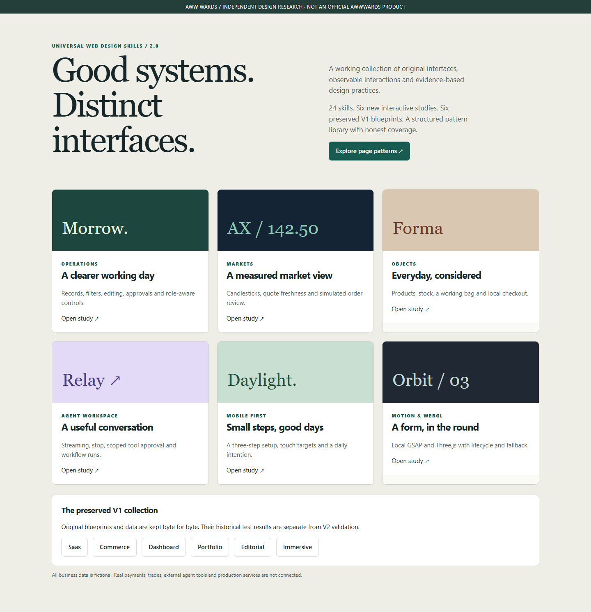

# Awwwards Web Design Skills · 页面专项扩展进行中

[](https://github.com/hxyang24/awwwards-web-design-skills/actions/workflows/ci.yml)
[](LICENSE)

> **当前新增页面专项 Skills 整理仍在进行，尚未完成全站与所有获奖外站内页覆盖。** 新增 51 套可单独安装的页面技能及 4 套具体交互机制，保留原 24 套核心技能，共 79 套。详细来源边界和缺口见 [页面技能目录](PAGE_SKILLS.md)。

[下载当前页面技能工作版](https://github.com/hxyang24/awwwards-web-design-skills/archive/refs/heads/main.zip) · [独立页面技能](skills) · [来源覆盖](research/live_pages/coverage.json)

一套从网站研究、页面设计到可运行原型与验证的 AI 技能库。保留 V1 的 12 套技能，新增 12 套专项，提供企业后台、金融模拟、电商、AI Agent、移动端、动效/3D 和视觉重建工具。

**保留的 v2.0.1 基础包：24 套核心技能 · 82 个页面模式 · 22 个业务演示路由 · 6 个交互模板 + 6 个 V1 蓝本。** 82 个模式中的其余 60 个属于设计/实现规范，不代表全部已开发。真实业务服务未连接。

[下载既有 v2.0.1 稳定包](https://github.com/hxyang24/awwwards-web-design-skills/releases/tag/v2.0.1) · [执行入口](package/V2_START_HERE.md) · [覆盖矩阵](package/v2/docs/COVERAGE.md) · [实测与未测](package/v2/docs/VALIDATION.md)



## 快速启动

需要 Node.js 20+。本地演示所需浏览器模块已经随包提供，启动无需 npm install：

```sh
git clone https://github.com/hxyang24/awwwards-web-design-skills.git
cd awwwards-web-design-skills/package
node v2/server.mjs
```

打开 http://127.0.0.1:4173/ 。不要用 file:// 打开模块页面。`START_V2.cmd` 与 `START_V2.sh` 也位于 package 目录。

## 安装技能与导出模板

Python 3.10+，在 package 目录运行。目标路径由你指定，已有同名技能或非空项目不覆盖：

```sh
python v2/tools/install.py --list
python v2/tools/install.py --target /path/to/your/skills
python v2/tools/route_task.py --task "金融交易终端按照截图重建"
python v2/tools/scaffold.py --kind enterprise --output /path/to/empty-project
```

模板种类：enterprise、fintech、commerce、agent、mobile、studio。新项目中运行 `node v2/server.mjs`。完整包仍为集中资源位置，安装后的新技能通过 `PACKAGE_LOCATION.json` 定位它。

## 技能与示例

| 层次 | 内容 |
|---|---|
| 原有 12 技能 | workflow、research、reference、design-system、layout、motion、webgl、content、product-ux、components、quality、release |
| 新增业务技能 | page-library、enterprise、fintech、ecommerce、ai-agent |
| 新增实现与验证 | mobile、advanced-motion、3d-experience、design-intelligence、visual-reconstruction、visual-diff、acceptance-docs |
| 新模板 | Morrow 后台、Axis 金融模拟、Forma 电商、Relay Agent、Daylight 移动网页、Orbit 动效/3D |
| 研究资料 | 206 条历史档案、30 个代表案例及来源、未知和冲突记录；本轮未逐站重新核验 |

所有完整技能名以 `awwwards-` 开头，位于 [package/skills](package/skills)。已有框架可复用行为契约，不需要迁移到原生 HTML 模板。

## 测试

以下为交付时 Windows 环境的实际结果；在线 Linux CI 是另一组验证，状态见页面顶部。

| 检查 | 交付结果 |
|---|---:|
| V1 原文件保留 | 187/187 SHA-256 匹配 |
| V1 独立重跑 | 42/42 |
| 新逻辑测试 | 24/24 |
| 安装、导出、契约与路由工具 | 8/8 |
| 浏览器检查 | 57/57 |
| 自动无障碍扫描 | 12 次，选定规则无违规；不是完整 WCAG 审计 |
| 原交付 ZIP 干净解压检查 | 18/18；公开版另附自己的哈希与回执 |

在 package/v2 目录，先检查完整性，再安装开发依赖、运行测试：

```sh
python tools/verify.py
npm ci
npx playwright install chromium
npm test
npm run test:tools
npm run test:browser
npm run test:export
```

重测会更新 evidence，之后与出厂清单出现哈希差异是预期行为；只查结构与 V1 保留用 `python tools/verify.py --structure-only`。测试依赖和 Chromium 初次安装需要联网。

## 视觉重建与限制

提供授权参照简报、PNG 尺寸/主色提取、统一视口截图、整体与关键区域差异图，以及原创页面的独立重建示例。该示例在同一环境的 390/1440 宽度通过比对，不代表可自动逐页复刻任意第三方网站。详见 [重建说明](package/v2/docs/RECONSTRUCTION.md)。

全部业务为本地虚构演示：没有真实支付、交易、行情、模型调用、服务端授权或持久化。未完成生产部署、真机、Safari/Firefox、真实用户性能和完整无障碍验收。复杂 shader、生产级物理引擎、OCR/字体识别及高级跨页动画未实装；另附原创有界装饰物理模型，边界见专项说明。

## 开源与版权

原创代码、技能及原创文档以 [MIT](LICENSE) 开源。**第三方组件不被重新许可：GSAP 使用其标准许可，不是 MIT；Three.js 保留 MIT。** 研究资料及链接不授予原站设计、品牌、代码或素材复制权。详见 [第三方声明](THIRD_PARTY_NOTICES.md)。

这是独立研究与原创实现项目，与 Awwwards 无隶属或背书关系。公开版移除私人聊天标识、规范化少量元数据，并修正 Linux 在线测试的详情页等待条件，旧版 187 文件仍保留原字节，见 [公开发布记录](docs/OPEN_SOURCE_PUBLICATION.md)。

## 页面与具体机制 Skills 扩展

从根目录执行 `python tools/install_all_skills.py --target YOUR_SKILLS_DIRECTORY` 可同时安装原 24 套核心与新增页面技能。新页面技能各自包含 `SKILL.md`、页面契约、独立 HTML/CSS/JS 原创蓝本和不覆盖导出脚本。主站页面与外站内页的结构、交互、状态、响应式、动效、来源和版权边界均进入技能，而不是只有网址。

原站内容只作为观察证据。完整 HTML、原站截图、代码、图片、字体、视频及音乐不随新增公开研究记录分发。新增技能的几何插图和蓝本为原创。观察缺口、受限访问、未验证的隐藏交互与未接入服务端持续保留。

具体机制包括发现门户导航、雇主品牌与价值观画廊、图形失败回退、有界物理装饰，入口见 [机制说明](INTERACTION_SKILLS.md)。本轮另增加章节索引、交互叙事阅读与提示词详情三套独立页面蓝本，见 [新页面说明](CREATIVE_PAGE_SKILLS.md)。

本轮 Windows 检查：30 项页面工具、5 项机制工具、8 项物理模型、10 项定价模型、12 项来源采样、43 组完整页面、37 组通用机制、35 组叙事/提示词及 16 组物理专项浏览器检查通过。章节蓝本含完整三章无脚本路径，物理与采样边界见 [专项说明](PHYSICS_AND_SOURCE_AUDIT.md)。另有 23 组定价页专项验证，见 [定价 Skill](PRICING_PAGE_SKILL.md)，覆盖单位换算、小数、未知费用、手机比较与失败恢复。在线 CI 会独立重跑。187 个 V1 文件与基础包封存清单仍匹配。来源观察、原创蓝本和真实业务验收分别记录。

新增 [杂志与文章索引 Skill](EDITORIAL_PAGE_SKILL.md)，提供精选、主题、全文搜索、渐进加载、阅读返回和完整静态路径。来源目标采样新增 10 项歧义保护检查；原创目录模型 12 项及页面 30 组专项检查通过。

完善现有 [商品详情 Skill](PRODUCT_PAGE_SKILL.md)，商品页专项继续保留。新增原创商品图库、放大与键盘、颜色/尺寸/加急选项、库存状态、整数金额估算、失败恢复与静态回退；31 组商品浏览器、12 项模型、7 项字段夹具检查通过。源站只观察到单一颜色与加急状态及准备时间变化，未声称价格重算或真实购买通过。

新增独立 [商品集合与即时筛选 Skill](COLLECTION_PAGE_SKILL.md)：全目录查询、即时多维筛选、未知价格、修订游标、继续加载、完整商品信息与返回恢复。40 组集合浏览器、18 项目录模型及 7 项连续观察检查通过；当前共 77 套技能，全站仍在整理。

新增 [技术产品详情 Skill](TECHNICAL_PRODUCT_SKILL.md)：规格与性能证据、饰面、二维配置示意、单位、可访问面板和仅本地项目简报。21 组浏览器、13 项模型及 8 项内容/滚动观察夹具通过；原站四面板仅作有限观察，源站厂商数据和素材未打包。当前 76 套，全站与外站内页范围未完成。

新增 [主站灵感参考详情 Skill](REFERENCE_PAGE_SKILL.md)：原创 VP8 短片、静态出处与主题、字幕/全文、明确播放和真实可定位状态、本机笔记及复制失败回退。固定快照28组参考浏览器、12项模型、28项工具与完整49页43组检查通过；当前77套，全站仍在逐页提炼。

本次升级既有 [作者作品主页 Skill](CREATOR_PROFILE_SKILL.md)，总数仍77套：八项完整原创作品、报告/目录/匹配/可见数量分离、未知与零、筛选展开、阅读返回、仅本机短名单和不可用回退。固定快照30组作者浏览器、12项模型、30项页面工具及完整49页43组通过。三个主站地址复用既有类型，不按网址重复增加Skill；全站仍未完成。

最新新增 [品牌指南 Skill](BRAND_GUIDE_SKILL.md)：原创色板、标志、几何图标组合、对比度计算、复制回退、可控动效与完整静态资源。四个已观察来源章节合为一套任务技能。固定快照30组品牌浏览器、13项模型、32项页面工具、完整50页44组通过，原V1 187文件保持一致；全站仍未完成。此前77套作者主页增强保持兼容。

最新新增 [房地产三维浏览 Skill](PROPERTY_EXPLORER_SKILL.md)：原创双楼栋与12空间、显式软件WebGL绘制、镜头/时间、射线点选与键盘列表、即时过滤、未知值、详情返回和本地简报。固定快照38组图形浏览器、18项模型、34项页面工具及完整51页45组通过。新增150个页面结果不是150套Skill；全站仍未完成。此前78套和原V1文件保持兼容。
